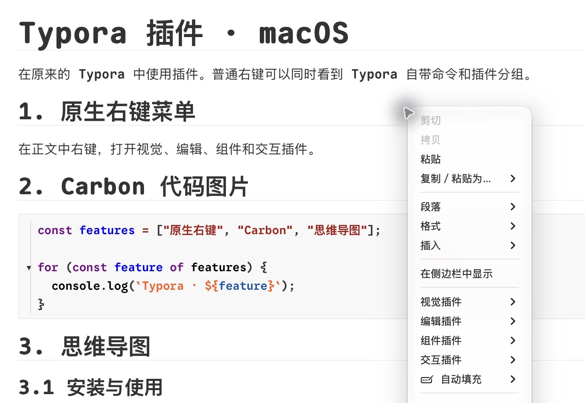
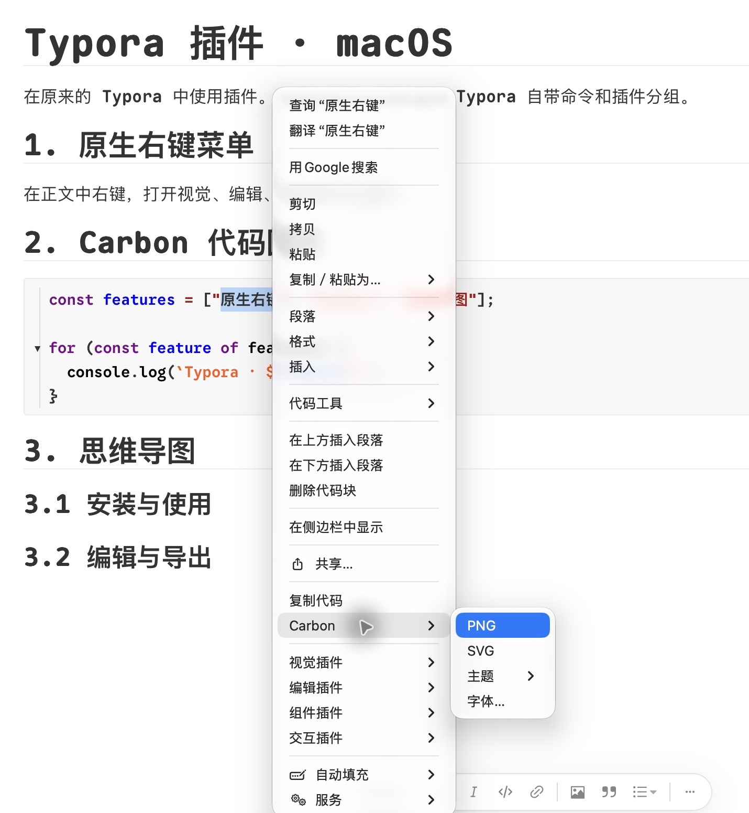
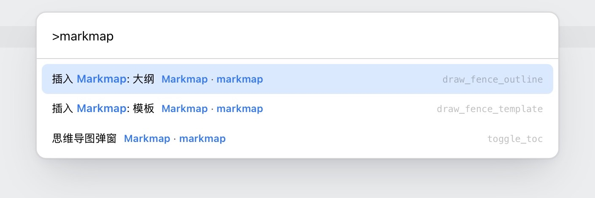
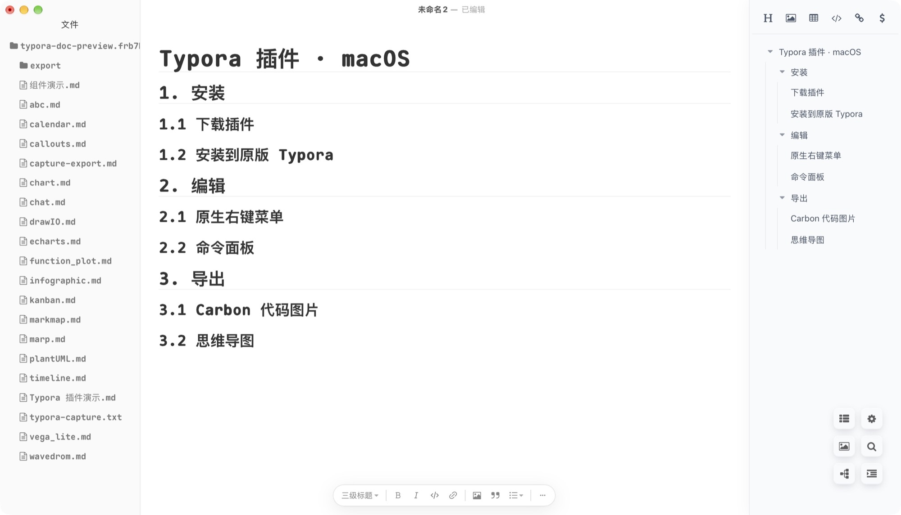
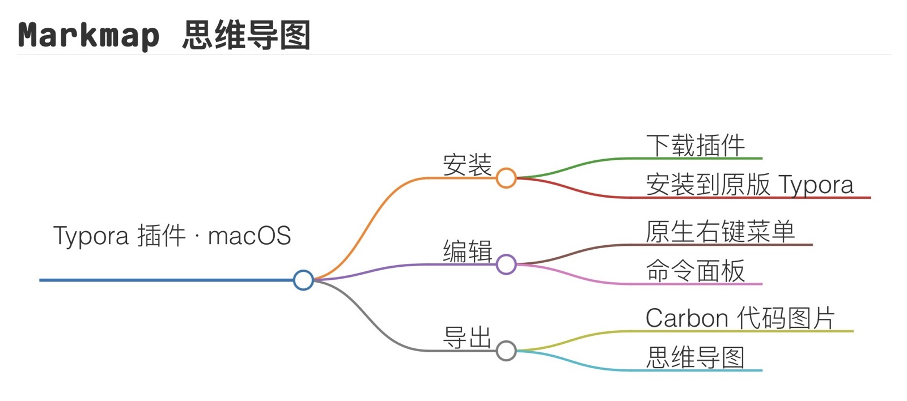
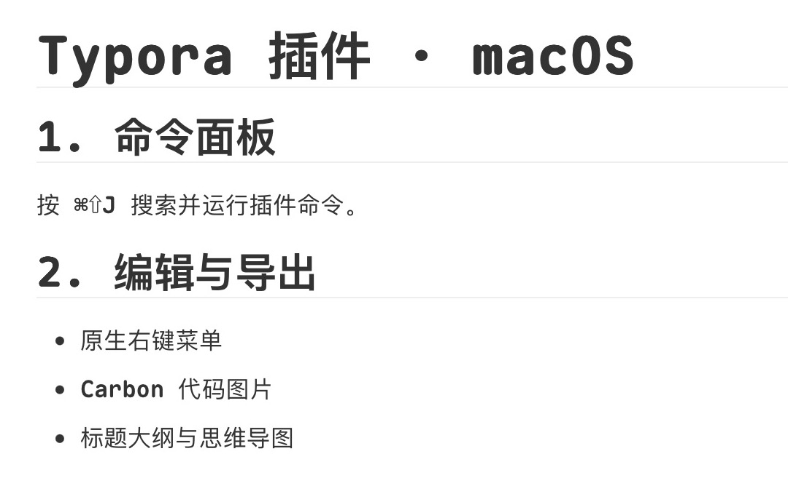
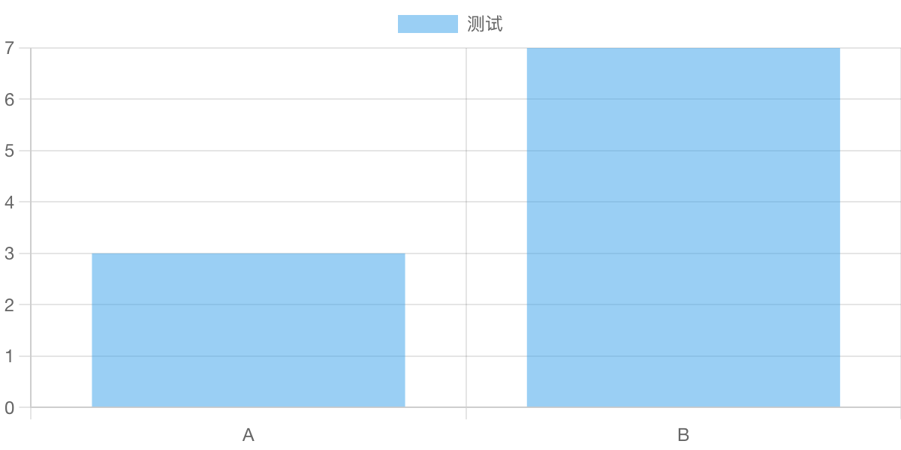
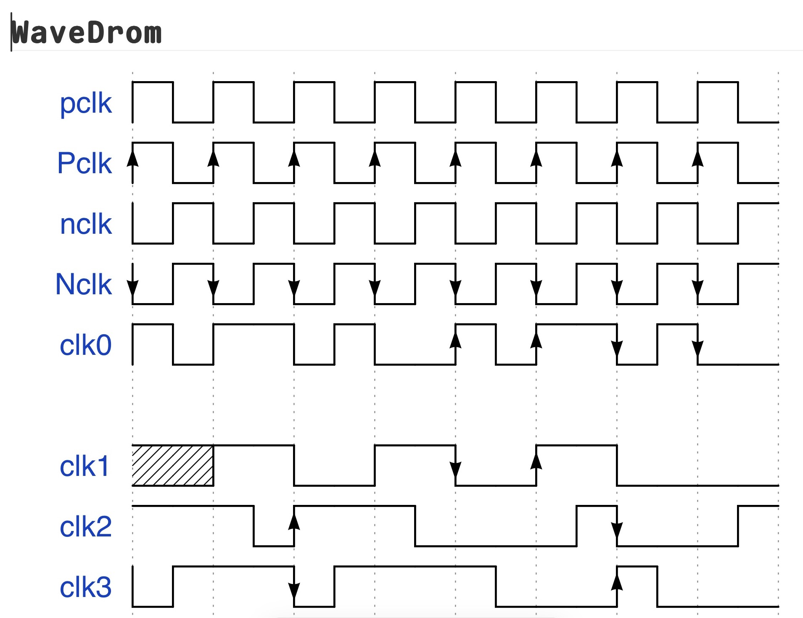

[English](README.md) | 简体中文

<div align="center">
  <a href="https://github.com/sansan-01"></a>
  <h1>Typora Plugin for macOS</h1>
  <p>装进你现有的 Typora，继续从 Dock 或访达打开原来的应用。</p>
  <p>
    <a href="https://github.com/sansan-01/typora-plugin-macos/releases">Releases</a> ·
    <a href="https://github.com/sansan-01/typora-plugin-macos/issues">Issues</a> ·
    <a href="https://github.com/sansan-01/typora-plugin-macos/stargazers">Stars</a> ·
    <a href="https://github.com/sansan-01/typora-plugin-macos/releases/latest/download/typora-plugin-macos.zip">下载 macOS 安装包</a>
  </p>
</div>

## 致谢

感谢 **obgnail** 和上游贡献者开发 Typora Plugin。本项目由 **sansan-01** 在原项目基础上修改和维护，面向 macOS。[原项目 obgnail/typora_plugin](https://github.com/obgnail/typora_plugin) · [维护者 sansan-01](https://github.com/sansan-01)

也感谢 bfyes 的 macOS 兼容工作，以及 Carbon 项目提供的主题配色。[Typora-plugin-on-Mac](https://github.com/bfyes/Typora-plugin-on-Mac) · [Carbon](https://github.com/carbon-app/carbon)

## 安装

实机验证环境为 **Apple 芯片 Mac、Typora 1.14.15**。安装需要 Python 3、Xcode 命令行工具，以及 Node.js 22.20 或更高版本，也可使用已安装的 Visual Studio Code 提供的运行环境。其他 Typora 版本和 Intel Mac 仍待验证。

1. 下载 [macOS 安装包](https://github.com/sansan-01/typora-plugin-macos/releases/latest/download/typora-plugin-macos.zip) 并解压。
2. 正常退出 Typora。在终端进入解压后的项目目录，运行下面的命令。
3. 从 Dock 或访达打开原来的 Typora，在正文右键确认出现插件分组。

```sh
python3 -B macos/install.py
```

安装器会备份原应用。更新或卸载步骤见 [macOS 安装说明](macos/README.md)。



## 常用功能

[查看全部功能](#全部功能)

| 功能 | 怎么用 |
| --- | --- |
| 原生右键 | 在正文右键，展开「视觉」「编辑」「组件」或「交互」。按住 `⌥` 右键可只看 Typora 自带的命令。 |
| 命令面板 | 按 `⌘⇧J` 搜索并执行插件命令。 |
| 标签页和大纲 | 从同一个窗口打开多个文件，顶部显示标签。标签栏会跟随左侧文件栏的宽度，给大纲切换和搜索按钮留出位置。右下角的列表按钮可打开右侧标题大纲。 |
| 大纲思维导图 | 点击右下角六个按钮中的左下角树形按钮，用 Markmap 把当前文档的标题层级生成思维导图。 |
| Carbon 代码图片 | 在代码块里右键，打开「Carbon」，选择 PNG 或 SVG。也可在子菜单中切换主题和本机字体。 |
| 模糊模式 | 在正文右键，从「视觉」开启模糊模式。当前编辑的段落保持清晰。 |



<details>
<summary>查看 Mac 实拍和导出示例</summary>

**命令面板**



**左侧文件树和右侧标题大纲**



**正文内的 Markmap 思维导图**



**模糊模式**

| 关闭 | 开启 |
| --- | --- |
|  |  |

**渲染组件**

| Chart.js 导出图 | WaveDrom 实拍 |
| --- | --- |
|  |  |

</details>

## 全部功能

下表覆盖 67 个上游插件和 Mac 版的专属功能。✅ 表示已实现或已接入，❌ 表示所列功能尚未完整实现。「待实测」表示已接入，Mac 上的实际操作仍待核对。

### 导航与管理

| 插件 | 功能 | Mac 状态 |
| --- | --- | --- |
| `window_tab` | 标签页管理 | ✅ 标签创建、切换及跟随侧栏已实测 |
| `search_multi` | 多元文件搜索 | ✅ 已接入，待实测 |
| `auto_number` | 章节、表格、图片、代码块等自动编号 | ✅ 已实测，范围见验收表 |
| `bookmark` | 书签管理器 | ✅ 已接入，待实测 |
| `cursor_history` | 光标跳转 | ✅ 已接入，待实测 |
| `preferences` | 插件配置 | ✅ 已实测，范围见验收表 |
| `updater` | 一键升级插件 | ❌ 检查与暂存已接入；一键应用与重启未实现 |
| `asset_root_redirect` | 资源重定向 | ✅ 已接入，待实测 |
| `repository` | 管理 Typora 打开过的文件夹 | ✅ 已接入，待实测 |
| `ripgrep` | 基于 ripgrep 的文件检索 | ✅ 已接入，待实测 |

### 编辑增强

| 插件 | 功能 | Mac 状态 |
| --- | --- | --- |
| `collapse_paragraph` | 章节折叠 | ✅ 已接入，待实测 |
| `collapse_list` | 列表折叠 | ✅ 已接入，待实测 |
| `collapse_table` | 表格折叠 | ✅ 已接入，待实测 |
| `collapse_image` | 长图折叠 | ✅ 已接入，待实测 |
| `md_padding` | 中英文混排优化 | ✅ 已接入，待实测 |
| `slash_commands` | 斜杠命令 | ✅ 已接入，待实测 |
| `mouse_gestures` | 鼠标手势 | ✅ 已接入，待实测 |
| `templater` | 文件模板 | ✅ 已接入，待实测 |
| `fence_enhance` | 复制、折叠、格式化代码 | ✅ 已接入，待实测 |
| `right_outline` | 在右侧生成大纲目录 | ✅ 已实测，范围见验收表 |
| `commander` | 命令行环境 | ✅ 已实测，范围见验收表 |
| `command_palette` | 命令面板 | ✅ 已实测，范围见验收表 |
| `right_click_menu` | 右键菜单统一管理插件 | ✅ 已实测，范围见验收表 |
| `pie_menu` | 圆盘菜单 | ✅ 已接入，待实测 |
| `datatables` | 表格增强（搜索、过滤、分页、排序等） | ✅ 已接入，待实测 |
| `resize_table` | 调整表格行高列宽 | ✅ 已接入，待实测 |
| `resize_image` | 调整图片显示大小 | ✅ 已接入，待实测 |
| `easy_modify` | 编辑工具 | ✅ 已接入，待实测 |
| `editor_width_slider` | 写作区宽度调整 | ✅ 已接入，待实测 |
| `cjk_symbol_pairing` | 中文符号配对 | ✅ 已接入，待实测 |
| `text_stylize` | 文字风格化 | ✅ 已接入，待实测 |
| `resource_manager` | 一键清除无用图片 | ✅ 已接入，待实测 |
| `markdownlint` | markdown 格式检查 | ✅ 已接入，待实测 |
| `export_enhance` | 导出 HTML/PDF 时避免图片丢失 | ✅ 已实测，范围见验收表 |
| `html_editor` | 在主编辑区预览和编辑 HTML 文件 | ✅ 已接入，待实测 |
| `assets_storage` | 修改资源存储位置 | ✅ 已接入，待实测 |
| `cipher` | 文件加密与解密 | ✅ 已接入，待实测 |

### 组件

| 插件 | 功能 | Mac 状态 |
| --- | --- | --- |
| `markmap` | 集成 Markmap | ✅ 大纲弹窗比例与正文渲染已实测 |
| `echarts` | 集成 Echarts | ✅ 已接入，待实测 |
| `vega_lite` | 集成 Vega-Lite | ✅ 已接入，待实测 |
| `chart` | 集成 Chart.js | ✅ 已实测，范围见验收表 |
| `drawIO` | 集成 DrawIO | ✅ 已实测，范围见验收表 |
| `abc` | 集成 abc.js | ✅ 已实测，范围见验收表 |
| `calendar` | 集成 tui.calendar | ✅ 已接入，待实测 |
| `wavedrom` | 集成 Wavedrom | ✅ 已实测，范围见验收表 |
| `marp` | 集成 Marp | ✅ 已接入，待实测 |
| `plantUML` | 集成 PlantUML | ✅ 已接入，待实测 |
| `infographic` | 集成 Infographic | ✅ 已接入，待实测 |
| `function_plot` | 集成 Function Plot | ✅ 三条示例曲线已实测 |
| `callouts` | 集成 Callouts | ✅ 已实测，范围见验收表 |
| `kanban` | 看板组件 | ✅ 已接入，待实测 |
| `timeline` | 时间线组件 | ✅ 已接入，待实测 |
| `chat` | 对话组件 | ✅ 已接入，待实测 |

### 视图与主题

| 插件 | 功能 | Mac 状态 |
| --- | --- | --- |
| `dark` | 夜间模式 | ✅ 已接入，待实测 |
| `no_image` | 无图模式 | ✅ 已接入，待实测 |
| `blur` | 模糊模式 | ✅ 已实测，范围见验收表 |
| `myopic_defocus` | 离焦视力舒缓 | ✅ 已接入，待实测 |
| `read_only` | 只读模式 | ✅ 已接入，待实测 |
| `image_viewer` | 图片查看器 | ✅ 已接入，待实测 |
| `truncate_text` | 暂时隐藏内容，提高大文件渲染性能 | ✅ 已接入，待实测 |
| `diagram_enhance` | 图表缩放、平移、全屏与尺寸调整 | ✅ 已接入，待实测 |
| `static_markers` | Markdown 标记常显 | ✅ 已接入，待实测 |
| `sidebar_enhance` | 显示其他扩展名文件、记忆折叠状态、拖拽排序 | ✅ 已接入，待实测 |

### 高级功能

| 插件 | 功能 | Mac 状态 |
| --- | --- | --- |
| `hotkeys` | 快捷键注册中心 | ✅ 已接入，待实测 |
| `action_buttons` | 悬浮功能按钮注入 | ✅ 已实测，范围见验收表 |
| `remote_control` | JSON-RPC 外部控制接口 | ✅ 已实测，范围见验收表 |
| `article_uploader` | 跨平台文档发布引擎 | ❌ Mac 发布所需依赖未接入 |

### Mac 专属功能与已知差异

| 功能 | Mac 状态 |
| --- | --- |
| 从 Dock 或访达直接启动原来的 Typora | ✅ 已实测 |
| 正文右键整合四组插件 | ✅ 已实测 |
| 标签栏随左侧文件栏移动 | ✅ 已实测 |
| 从标题生成 Markmap 大纲思维导图 | ✅ 已实测 |
| 仅代码块右键显示 Carbon | ✅ 已实测 |
| Carbon 导出 PNG、SVG 到插件临时目录 | ✅ 原生 SVG 已实测；PNG 有既有导出验证，原生入口待复测 |
| Carbon 主题和本机字体 | ✅ 已接入 29 套主题和本机字体；原生选择入口待复测 |
| 检查更新并暂存 | ✅ 检查与暂存流程已验证 |
| 一键应用更新并自动重启 | ❌ 应用更新须退出 Typora 后重新运行安装脚本 |
| WordPress、博客园、CSDN 发布 | ❌ 发布依赖尚未接入 Mac |
| 原生右键的「常用／少用」两组 | ❌ 当前默认使用四组分类 |
| 原生右键的快捷键标注、仅插件模式及子菜单外观设置 | ❌ 原生菜单未接入这些上游选项 |
| 将 Typora 右上角的原生图标整体左移 | ❌ 原生控件的位置未调整 |

## 兼容性与反馈

本项目保留了上游插件模块，Mac 上的实测范围和已知缺口见 [功能验收表](macos/Typora%20Mac%20功能验收表.md) 和 [Windows 与 macOS 功能对照](macos/Windows与macOS功能对照.md)。想了解原版插件的全部用法，可查阅 [上游功能文档](https://github.com/obgnail/typora_plugin/blob/master/README-cn.md#插件列表)。

遇到 Mac 版的问题，可以在 [本仓库提交 Issue](https://github.com/sansan-01/typora-plugin-macos/issues/new)，附上 Typora 版本、macOS 版本和复现步骤。欢迎在 [本仓库首页](https://github.com/sansan-01/typora-plugin-macos) 点右上角的 **Star**。

本项目采用 [MIT 许可证](LICENSE)，并保留上游版权声明。
