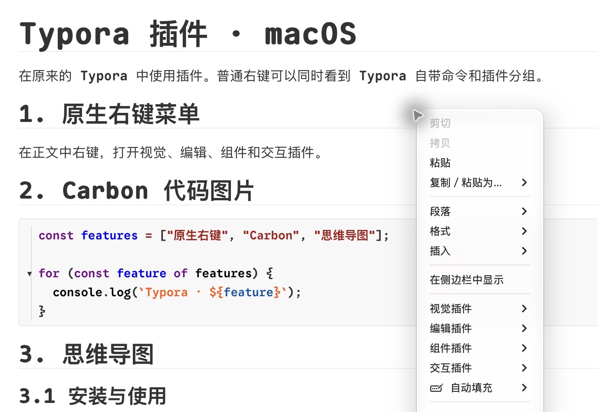
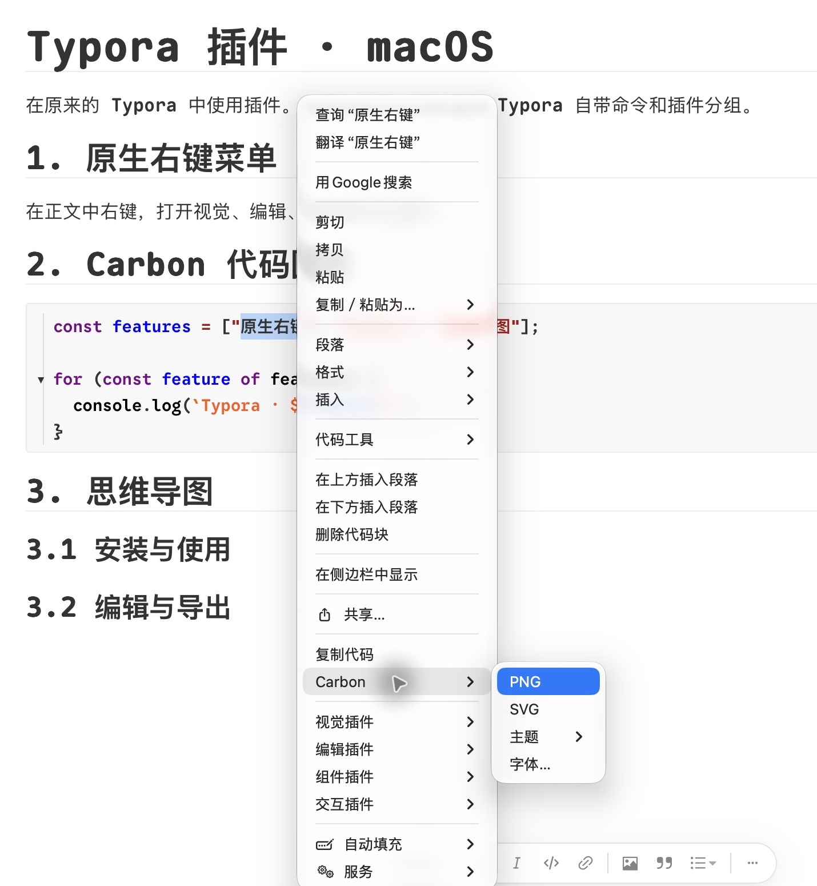
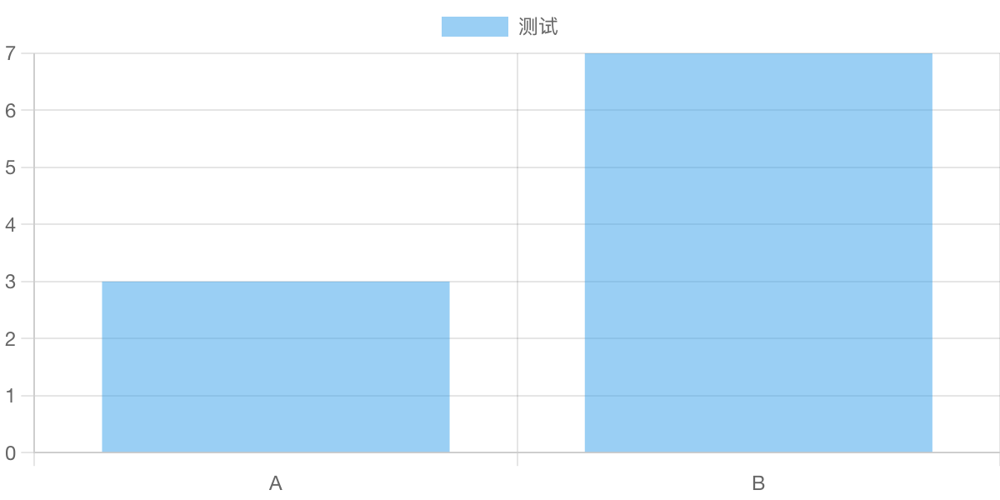
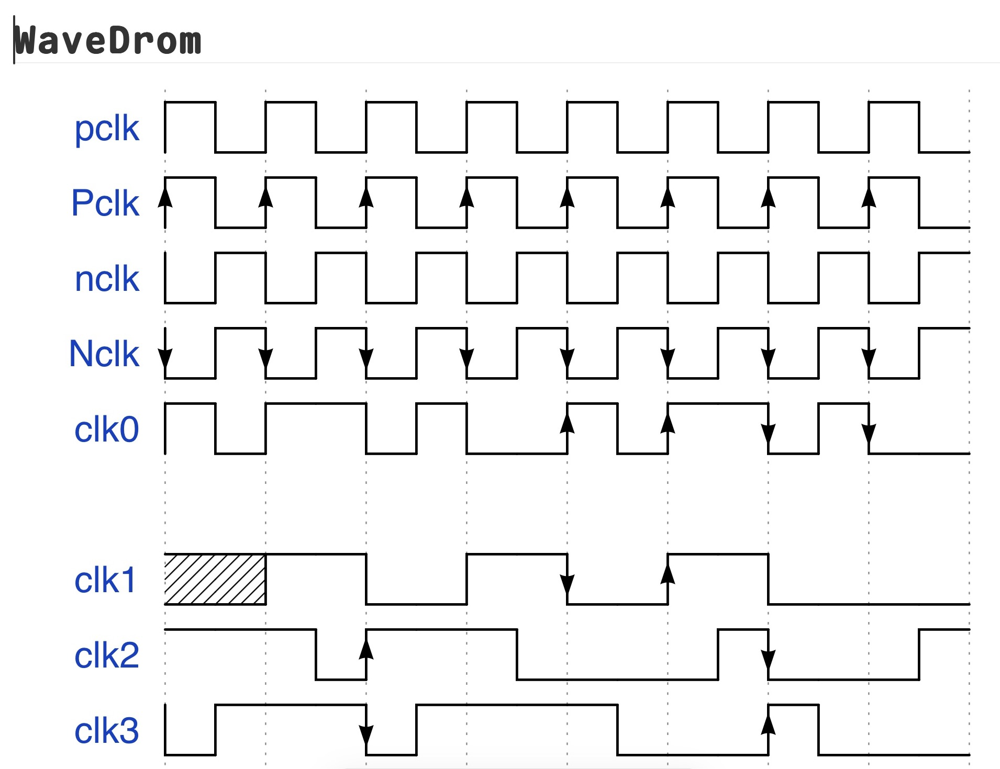

English | [简体中文](README-cn.md)

<div align="center">
  <a href="https://github.com/sansan-01"></a>
  <h1>Typora Plugin for macOS</h1>
  <p>Maintained by <a href="https://github.com/sansan-01">sansan-01</a></p>
</div>

## macOS

[Installation guide](macos/README.md) · [Feature verification table](macos/Typora%20Mac%20功能验收表.md)



### Credits

This macOS edition builds on [Typora Plugin by obgnail and its contributors](https://github.com/obgnail/typora_plugin). Thanks to [bfyes](https://github.com/bfyes/Typora-plugin-on-Mac) for the macOS compatibility work and to the [Carbon contributors](https://github.com/carbon-app/carbon) for the theme palettes.

## Plugin List

See the [upstream feature guide](https://github.com/obgnail/typora_plugin#plugin-list) for the original project documentation.

| Plugin: Navigation & Management             | Feature                    | Default |
| :------------------------------------------ | :------------------------- | :------ |
| [window_tab](#window_tab)                   | Window Tab Bar             |         |
| [search_multi](#search_multi)               | Multi-Fields File Searcher |         |
| [auto_number](#auto_number)                 | Auto Numbering             |         |
| [bookmark](#bookmark)                       | Bookmark Manager           | ×       |
| [cursor_history](#cursor_history)           | Cursor History Navigation  | ×       |
| [preferences](#preferences)                 | Global Configuration Panel |         |
| [updater](#updater)                         | One-Click Plugin Update    |         |
| [asset_root_redirect](#asset_root_redirect) | Local Resource Redirection | ×       |
| [repository](#repository)                   | Workspace Manager          | ×       |
| [ripgrep](#ripgrep)                         | File Retrieval             | ×       |

| Plugin: Enhance Editing                     | Feature                                      | Default |
| :------------------------------------------ | :------------------------------------------- | :------ |
| [collapse_paragraph](#collapse_paragraph)   | Chapter Folding                              | ×       |
| [collapse_list](#collapse_list)             | List Folding                                 | ×       |
| [collapse_table](#collapse_table)           | Table Folding                                | ×       |
| [collapse_image](#collapse_image)           | Long Image Collapse                          | ×       |
| [md_padding](#md_padding)                   | Chinese-English Text Spacer                  |         |
| [slash_commands](#slash_commands)           | Slash Commands                               |         |
| [mouse_gestures](#mouse_gestures)           | Mouse Gestures Recognition                   | ×       |
| [templater](#templater)                     | File Templater Engine                        |         |
| [fence_enhance](#fence_enhance)             | Code Block Enhancements                      |         |
| [right_outline](#right_outline)             | Right-Side Outline View                      |         |
| [commander](#commander)                     | Embedded Command-Line Environment            |         |
| [command_palette](#command_palette)         | Global Command Palette                       |         |
| [right_click_menu](#right_click_menu)       | Context Menu Integration                     |         |
| [pie_menu](#pie_menu)                       | Pie Menu                                     | ×       |
| [datatables](#datatables)                   | Table Enhancements (Filter, Sort, Paging)    | ×       |
| [resize_table](#resize_table)               | Table Resizer                                |         |
| [resize_image](#resize_image)               | Image Resizer                                |         |
| [easy_modify](#easy_modify)                 | High-Frequency Editing Toolset               |         |
| [editor_width_slider](#editor_width_slider) | Writing Area Width Adjustment                |         |
| [cjk_symbol_pairing](#cjk_symbol_pairing)   | CJK Symbol Auto-Pairing                      |         |
| [text_stylize](#text_stylize)               | Inline HTML Text Stylization                 |         |
| [resource_manager](#resource_manager)       | Static Resource Management                   |         |
| [markdownlint](#markdownlint)               | Markdownlint Static Analysis                 |         |
| [export_enhance](#export_enhance)           | Base64 Image Conversion for HTML/PDF Exports | ×       |
| [html_editor](#html_editor)                 | Native HTML Preview and Editor               | ×       |
| [assets_storage](#assets_storage)           | Modify resource storage location             | ×       |
| [cipher](#cipher)                           | Document Encryption and Decryption           | ×       |

| Plugin: Component               | Feature                  | Default |
| :------------------------------ | :----------------------- | :------ |
| [markmap](#markmap)             | Integrates Markmap       |         |
| [echarts](#echarts)             | Integrates ECharts       |         |
| [chart](#chart)                 | Integrates Chart.js      |         |
| [vega_lite](#vega_lite)         | Integrates Vega-Lite     |         |
| [drawIO](#drawIO)               | Integrates DrawIO        |         |
| [abc](#abc)                     | Integrates abc.js        |         |
| [calendar](#calendar)           | Integrates tui.calendar  |         |
| [wavedrom](#wavedrom)           | Integrates WaveDrom      |         |
| [marp](#marp)                   | Integrates Marp          |         |
| [plantUML](#plantUML)           | Integrates PlantUML      |         |
| [infographic](#infographic)     | Integrates Infographic   |         |
| [function_plot](#function_plot) | Integrates Function Plot |         |
| [callouts](#callouts)           | Integrates Callouts      |         |
| [kanban](#kanban)               | Kanban component         |         |
| [timeline](#timeline)           | Timeline component       |         |
| [chat](#chat)                   | Chat Bubble component    |         |

| Plugin: View & Theme                | Feature                                                   | Default |
| :---------------------------------- | :-------------------------------------------------------- | :------ |
| [dark](#dark)                       | Dark Mode Rendering                                       |         |
| [no_image](#no_image)               | Image-Free / Text-First Mode                              |         |
| [blur](#blur)                       | Focus Management (Gaussian Blur for Inactive Nodes)       |         |
| [myopic_defocus](#myopic_defocus)   | Defocus Visual Relief Filter                              |         |
| [read_only](#read_only)             | Read-Only State Lock                                      |         |
| [image_viewer](#image_viewer)       | Independent Image Viewer                                  |         |
| [truncate_text](#truncate_text)     | Viewport Offloading for Large File Rendering Optimization | ×       |
| [diagram_enhance](#diagram_enhance) | Diagram Zoom, Pan, Fullscreen, and Container Resizing     | ×       |
| [static_markers](#static_markers)   | Persistent Markdown Syntax Markers                        |         |
| [sidebar_enhance](#sidebar_enhance) | Drag Sorting, Non-MD Files, Fold States                   |         |

| Plugin: Advanced                      | Feature                                   | Default |
| :------------------------------------ | :---------------------------------------- | :------ |
| [hotkeys](#hotkeys)                   | Declarative Hotkey Registration Center    |         |
| [action_buttons](#action_buttons)     | Floating Action Buttons Injection         |         |
| [remote_control](#remote_control)     | JSON-RPC External Automation Interface    | ×       |
| [article_uploader](#article_uploader) | Cross-Platform Document Publishing Engine | ×       |

> Welcome to submit an [Issue](https://github.com/obgnail/typora_plugin/issues/new) to report bugs or discuss features, and Pull Requests are always welcome. If this project enhances your workflow, please consider leaving a Star ⭐.

## How to Use: Windows/Linux Platform

Refer to the [Installation Tutorial](https://github.com/obgnail/typora_plugin/issues/847) for visual guidance.

1. **Get source code package:** Download the latest release from the [Releases page](https://github.com/obgnail/typora_plugin/releases/latest) and extract the archive.

2. **Locate injection point:** Navigate to your Typora installation directory and locate the target folder containing `window.html` (referred to as Directory A).
   - For official Typora releases, the path is: `./resources/`
   - For free beta Typora releases, the path is: `./resources/app/`

3. **Deploy files:** Copy the extracted `plugin` folder and paste it entirely into Directory A.

4. **Execute installation script:** Enter the `A/plugin/bin/` directory.
   - **Windows:** Right-click on `install_windows.ps1` and select **Run with PowerShell**.
   - **Linux:** Execute `install_linux.sh` in the terminal with administrator privileges.

5. **Verify installation status:** Restart Typora, right-click within the main editor area to open the context menu. If plugin-related options are displayed, the underlying logic injection is successful.

## How to Use: Archlinux Platform

```sh
yay -S typora-plugin
# or
yay -S typora-free-with-plugin
```

> For details, please refer to [aur/typora-plugin](https://aur.archlinux.org/packages/typora-plugin) | [aur/typora-free-with-plugin](https://aur.archlinux.org/packages/typora-free-with-plugin).

## Plugin Usage Instructions

The plugin system provides seven interactive entry points to accommodate different workflows:

- **Keyboard-Based Interactions:**
  - Command Palette (via `command_palette` plugin)
  - Slash Commands Menu (via `slash_commands` plugin)
  - Global Hotkeys (via `hotkeys` plugin)
- **Pointer-Based Interactions:**
  - Context Menu (via `right_click_menu` plugin)
  - Mouse Gestures Recognition (via `mouse_gestures` plugin)
  - Floating Action Buttons (via `action_buttons` plugin)
  - Radial/Pie Menu (via `pie_menu` plugin)

## Navigation & Management

### window_tab

Provides multi-document tab management.

### search_multi

Supports high-precision file retrieval through multi-condition combinations using query syntax.

### auto_number

Automatically generates sequence numbers for document elements including chapter headers, tables, images, and code blocks.

> Unlike pure CSS rendering schemes, this plugin intercepts core rendering functions, effectively resolving the technical limitation where sidebar directory numbering is lost during PDF export.

### bookmark

Bookmark manager. Usage:

1. Use `Alt + Left Click` on the text content to insert a bookmark marker.
2. Upon insertion, the bookmark management panel is automatically invoked. Click on the corresponding entry to quickly jump within the document.

### cursor_history

Records cursor activity trajectories to support contextual navigation.

- Navigate to the previous cursor position: `Alt + ←`
- Navigate to the next cursor position: `Alt + →`

### preferences

Provides a centralized graphical control panel for global plugin configurations.

### updater

Supports one-click online detection and fetching of update packages to upgrade the plugin system.

### asset_root_redirect

Resolves local static resource parsing anomalies caused by cross-platform collaboration tools (such as Obsidian or Joplin). These tools typically enforce specific resource root paths, causing broken links when the files are opened independently in Typora. This plugin allows users to forcibly redirect the local resource root directory within Typora.

### repository

Tracks and persists records of directories opened by Typora. Provides a dedicated management panel for retrieving, sorting, aliasing, removing, and quickly reopening historical workspaces.

### ripgrep

Encapsulates and integrates the native `ripgrep` retrieval engine within Typora, achieving ultra-fast global text matching and file searching.

## Enhance Editing

### collapse_paragraph

Supports expanding and collapsing all text paragraphs nested under `h1` through `h6` header nodes.

### collapse_list

Supports expanding and collapsing unordered lists, ordered lists, and task list nodes.

### collapse_table

Supports expanding and collapsing table nodes as a whole.

### collapse_image

Supports expanding and collapsing long image.

### md_padding

Normalizes typography experiences: Automatically inserts whitespace (Pangu spacing) between Chinese and English, and between Chinese and numeric boundaries.

### slash_commands

Provides a Notion-style slash (`/`) command invocation menu.

### mouse_gestures

Provides global mouse gesture recognition and operation mapping.

### templater

A lightweight document template engine. Supports predefined content architectures for rapid file initialization.

### fence_enhance

Enhances code blocks with one-click copy, fold view, and code formatting operations.



### right_outline

Injects an independent outline directory view on the right side of the editing area, addressing native Typora's limitation of not displaying both the [File Tree] and [Document Outline] simultaneously.

### commander

Provides an embedded lightweight command-line environment for executing custom Shell instructions and interactive script operations.

### command_palette

Implements a global command palette analogous to VS Code (Shortcut: `Ctrl+Shift+P`).

### right_click_menu

Integrates interface functions across the plugin system into the native context menu for centralized interaction handling.

### pie_menu

Graphical radial menu component. Basic interaction protocol:

- `Invoke radial menu`: `Ctrl + Right Mouse Button`
- `Rotate radial menu`: Scroll Middle Mouse Button
- `Lock menu state (disable auto-hide)`: Left Click on the center
- `Expand secondary menu (disable auto-collapse)`: Right Click on the center

### datatables

Injects advanced interaction features into standard Markdown tables, including data retrieval, real-time filtering, frontend pagination, and multi-column sorting.

### resize_table

Dynamically adjust table row height and column width via `Ctrl + Mouse Drag` interaction.

### resize_image

Dynamically scale target image rendering sizes via `Alt + Mouse Scroll` interaction.

### easy_modify

Built-in high-frequency editing toolset, currently offering the following modules:

1. Extract and copy the full outline path of the current header level
2. Promote the header level of the selected text
3. Demote the header level of the selected text
4. Force line break conversion: `CRLF` to `LF`
5. Force line break conversion: `LF` to `CRLF`
6. Batch remove invisible control characters
7. Generate a mind map based on the current document outline (Markmap view)
8. Generate a mind map based on the current document outline (Graph view)
9. Extract selected text and derive it into a new file
10. Append a normalized blank line at the end of the document
11. Reformat all tables

### editor_width_slider

Provides a draggable slider mechanism to dynamically adjust the width boundaries of the core editor text area.

### cjk_symbol_pairing

Implements auto-pairing closure and cursor rollback for CJK punctuation (e.g., `《`, `【`, `（`, `「`) and quotation marks.

### text_stylize

Quickly applies custom or preset rich text styles to the currently selected text by encapsulating inline HTML tags.

### markdownlint

Markdown specification analyzer. Detects syntax patterns deviating from best practices and provides automated remediation.

### resource_manager

Workspace static resource manager. Executes dependency analysis and safely clears redundant images in the current directory that are not referenced by any Markdown documents.

### export_enhance

Intercepts HTML/PDF export streams. Forces referenced local images to convert into Base64 inline formats before generating render files, preventing subsequent external resource dependency breakage.

### html_editor

Directly loads and renders `.html` / `.htm` files within Typora's core editing area. Supports source viewing, real-time preview, split-pane modes, element inspection, document navigation, and write-conflict safety mechanisms.

Preview mode strictly blocks script execution and external network requests by default. It is recommended to explicitly enable `PREVIEW_ALLOW_SCRIPTS` or `PREVIEW_ALLOW_NETWORK` only when operating on files within a trusted environment.

### assets_storage

Modify resource storage location.

### cipher

Provides a document security module based on standard cryptographic algorithms, supporting local file encryption storage and decryption mounting.

## Component

<table width="100%">
<tr>
<td width="33.33%" align="center"><a id="chart"><b>Chart.js</b></a><br></td>
<td width="33.33%" align="center"><a id="echarts"><b>ECharts</b></a></td>
<td width="33.33%" align="center"><a id="markmap"><b>Markmap</b></a></td>
</tr>
<tr>
<td width="33.33%" align="center"><a id="vega_lite"><b>Vega-Lite</b></a></td>
<td width="33.33%" align="center"><a id="plantUML"><b>PlantUML</b></a></td>
<td width="33.33%" align="center"><a id="drawIO"><b>Draw.io</b></a></td>
</tr>
<tr>
<td width="33.33%" align="center"><a id="function_plot"><b>Function Plot</b></a></td>
<td width="33.33%" align="center"><a id="wavedrom"><b>WaveDrom</b></a><br></td>
<td width="33.33%" align="center"><a id="abc"><b>ABC</b></a></td>
</tr>
<tr>
<td width="33.33%" align="center"><a id="infographic"><b>Infographic</b></a></td>
<td width="33.33%" align="center"><a id="marp"><b>Marp</b></a></td>
<td width="33.33%" align="center"><a id="calendar"><b>Calendar</b></a></td>
</tr>
<tr>
<td width="33.33%" align="center"><a id="timeline"><b>Timeline</b></a></td>
<td width="33.33%" align="center"><a id="kanban"><b>Kanban</b></a></td>
<td width="33.33%" align="center"><a id="chat"><b>Chat</b></a></td>
</tr>
</table>

<table width="100%">
<tr>
<td width="50%" align="center"><a id="markmap(TOC)"><b>Markmap (TOC)</b></a></td>
<td width="50%" align="center"><a id="callouts"><b>Callouts</b></a></td>
</tr>
</table>

## View & Theme

### dark

Provides a dark (night) mode rendering theme.

### no_image

Provides an image-free (text-first) rendering mode.

### blur

Focus management optimization: Only the currently active and focused node area remains clearly rendered; surrounding inactive areas automatically apply a Gaussian blur effect to minimize visual interference.

### myopic_defocus

Provides a defocus visual relief filter.

### read_only

Locks the current document content, blocking all modification operations. When active, a `ReadOnly` status identifier explicitly mounts in the bottom-right word count area.

### truncate_text

Rendering performance optimization solution for oversized documents. Temporarily offloads DOM nodes outside the viewport by setting their style to `display: none`, preventing the browser from executing costly global reflows, thereby significantly improving scroll and edit framerates; also serves as an anti-peeping measure.

> Principle: Does not modify underlying source file data; only manipulates the presentation layer to temporarily unload designated nodes from the rendering tree.

### image_viewer

Integrates a standalone built-in image browser module, supporting full-screen distraction-free previewing and basic image transformation edits.

### diagram_enhance

Enhances interaction for charts generated by Typora's rendering engine: Supports cursor-centered scrolling zoom, viewport drag panning, touch gesture recognition, original DOM full-screen viewing mechanisms, and eight-direction adaptive container boundary adjustments. The right-click context menu quickly triggers view position and scale resets.

### static_markers

Forces the retention of Markdown syntax markers (persistent rendering).

Disables the auto-hide callback logic for syntax markers in WYSIWYG mode, ensuring that formatting markers like `**`, `##`, and `_` remain explicitly rendered, functioning exactly as they would in a source code editor.

### sidebar_enhance

Extends the functional boundaries of the native file sidebar:

- Drag and drop outline header nodes to reorganize the document's physical structure.
- File tree view supports declaring and presenting non-Markdown system files.
- Persistently remembers the fold/expand states of outline tree nodes.
- Supports mounting custom file icon rules.
- Displays statistical counts of sub-files on directory nodes.

## Advanced

### hotkeys

Provides a declarative hotkey registration dispatcher. Supports binding any exposed interfaces provided by the internal plugin system, or any custom functions injected by the user, to global physical shortcut keys.

### action_buttons

Adopts a declarative configuration logic homologous to `hotkeys`, supporting the mapping of any plugin system interface functions to floating interactive buttons at the bottom of the interface.

### remote_control

Provides an external communication layer based on the `JSON-RPC` protocol, exposing core control privileges, including `typora-plugin`, as standard interfaces. This allows external third-party scripts or processes to programmatically control Typora.

For specific interface definitions and technical specifications, please refer to the sub-document: [README.md](https://github.com/obgnail/typora_plugin/blob/master/plugin/remote_control/README.md).

### article_uploader

A cross-platform document publishing engine. Supports automated pushing of rendered Markdown documents from the current workspace to pre-configured third-party content platforms via trigger behaviors (e.g., hotkeys or UI interactions).

For detailed platform support lists and configuration guidelines, please refer to the sub-document: [README.md](https://github.com/obgnail/typora_plugin/blob/master/plugin/article_uploader/README.md).

## Q&A

- **What are the Typora version requirements?** Typora version must be ≥ 0.9.98 (encompassing the last free beta version and subsequent official releases).
- **How to adjust plugin configurations?** `Right-click menu` -> `Interactive Plugins` -> `Preferences`. **All user preferences are respected**; every plugin and feature can be independently and permanently enabled or disabled.
- **How to execute a plugin system upgrade?** `Right-click menu` -> `Interactive Plugins` -> `Preferences` -> `Check for Updates`.
- **How to safely uninstall plugins?** `Right-click menu` -> `Interactive Plugins` -> `Preferences` -> `Uninstall Plugins`.
- **Is macOS supported?** This edition has been tested with Typora 1.14.15 on Apple silicon. See the [macOS installation guide](macos/README.md).
- **Other technical questions or discussions?** Please visit the [AI Wiki](https://deepwiki.com/obgnail/typora_plugin) for documentation or join the community discussions.

## Acknowledgements

- **GPL Licensed**: [PlantUML](https://plantuml.com/) | [Refractify Myopic Defocus](https://chromewebstore.google.com/detail/refractify-myopic-defocus/dpnfdlnkgojjihdmgmacnmheflkojijm?hl=en)
- **BSD Licensed**: [Vega-Lite](https://github.com/vega/vega-lite)
- **Apache Licensed**: [ECharts](https://echarts.apache.org/zh/index.html) | [draw.io](https://github.com/jgraph/drawio)
- **MIT Licensed**: [markmap](https://markmap.js.org/) | [Chart.js](https://www.chartjs.org/) | [abcjs](https://github.com/paulrosen/abcjs) | [tui.calendar](https://github.com/nhn/tui.calendar) | [Marp](https://marp.app/) | [WaveDrom](https://wavedrom.com/) | [DataTables](https://github.com/DataTables/DataTables) | [markdownlint](https://github.com/DavidAnson/markdownlint) | [Function Plot](https://github.com/mauriciopoppe/function-plot) | [Infographic](https://github.com/antvis/infographic)
- **Unlicensed / Public Domain**: [typora-tabbar-plugin](https://github.com/gatziourasd/typora-tabbar-plugin) | [typora-side-by-side](https://github.com/gruvw/typora-side-by-side) | [md-padding](https://github.com/harttle/md-padding)

## Conclusion

**This project follows the MIT license, feel free to enjoy it.**

If this toolset enhances your productivity, please consider leaving a Star ⭐ on GitHub, and feel free to share it with friends who share similar needs.
