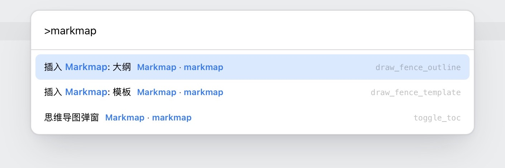
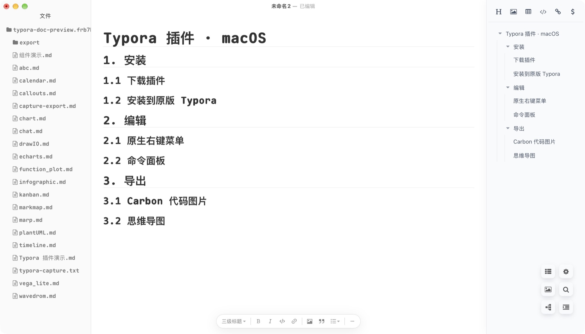
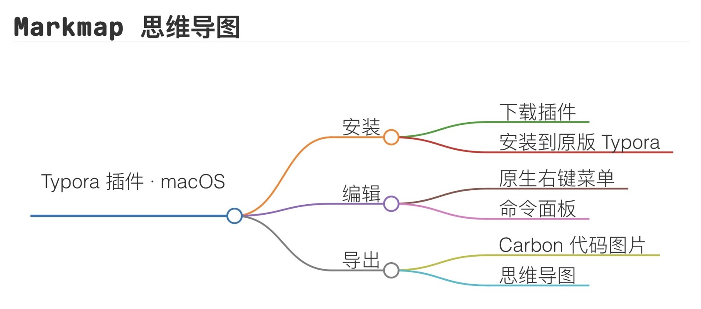
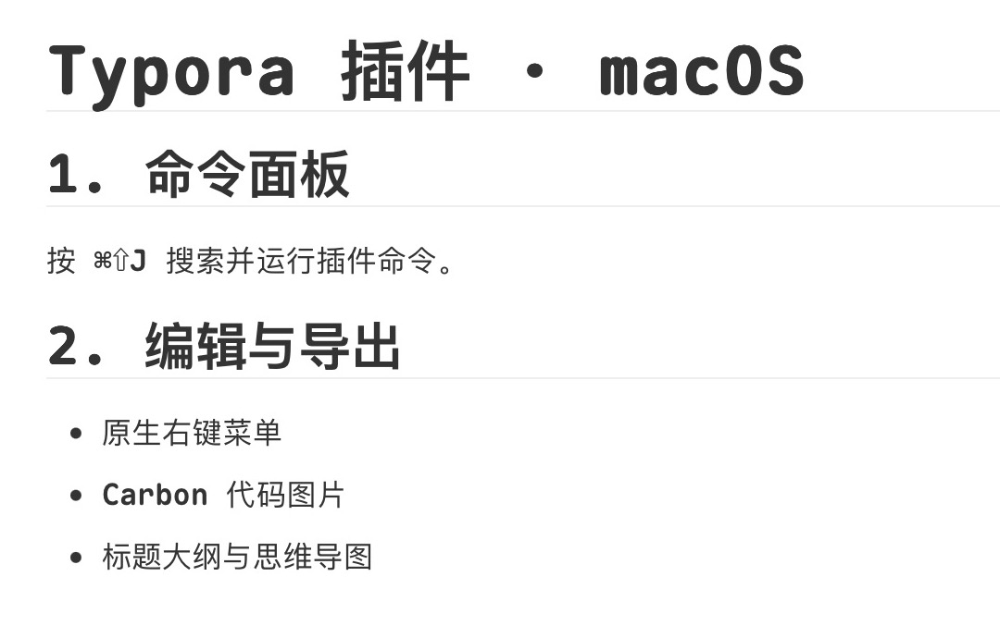

English | [简体中文](README-cn.md)

<div align="center">
  <a href="https://github.com/sansan-01"></a>
  <h1>Typora Plugin for macOS</h1>
  <p>Install the plugin into your existing copy of Typora and keep opening it from the Dock or Finder.</p>
  <p>
    <a href="https://github.com/sansan-01/typora-plugin-macos/releases">Releases</a> ·
    <a href="https://github.com/sansan-01/typora-plugin-macos/issues">Issues</a> ·
    <a href="https://github.com/sansan-01/typora-plugin-macos/stargazers">Stars</a> ·
    <a href="https://github.com/sansan-01/typora-plugin-macos/releases/latest/download/typora-plugin-macos.zip">Download macOS package</a>
  </p>
</div>

## Acknowledgements

Thank you to **obgnail** and the upstream contributors for creating Typora Plugin. **sansan-01** adapts and maintains this edition for macOS. [Original project](https://github.com/obgnail/typora_plugin) · [Maintainer](https://github.com/sansan-01)

Thanks also to bfyes for the macOS compatibility work and to Carbon for the theme palettes. [Typora-plugin-on-Mac](https://github.com/bfyes/Typora-plugin-on-Mac) · [Carbon](https://github.com/carbon-app/carbon)

## Install

Tested on **Apple silicon with Typora 1.14.15**. You need Python 3, the Xcode Command Line Tools, and Node.js 22.20 or later. An existing Visual Studio Code installation can supply the runtime instead. Other Typora versions and Intel Macs remain unverified.

1. Download and extract the [macOS package](https://github.com/sansan-01/typora-plugin-macos/releases/latest/download/typora-plugin-macos.zip).
2. Quit Typora. In Terminal, open the extracted project directory and run the command below.
3. Open Typora as usual from the Dock or Finder. Right-click in the editor and check that the plugin groups appear.

```sh
python3 -B macos/install.py
```

The installer backs up the original app. See the [macOS installation guide](macos/README.md) for update and uninstall instructions.


## Everyday features

[See all features](#feature-status)

| Feature | Where to find it |
| --- | --- |
| Native context menu | Right-click in the editor to find the four plugin groups. Hold `⌥` while right-clicking to show Typora's own commands only. |
| Command palette | Press `⌘⇧J` to search for and run plugin commands. |
| Tabs and outline | Open multiple documents in the same window to use tabs. The tab bar follows the left sidebar and leaves its outline and search controls accessible. The list button in the lower-right opens the right-hand outline. |
| Outline mind map | Click the tree icon at the lower left of the six buttons in the lower-right corner. Markmap turns the current document's headings into a mind map. |
| Carbon code images | Right-click inside a code block and choose **Carbon** to export PNG or SVG, choose a theme, or select a font installed on your Mac. |
| Blur mode | Find Blur Mode in the visual plugin group. The block you're editing stays in focus. |


<details>
<summary>macOS screenshots and exports</summary>

**Command palette**



**File tree and right-hand outline**



**Inline Markmap**



**Blur mode**

| Off | On |
| --- | --- |
|  |  |

**Rendering plugins**

| Chart.js export | WaveDrom screenshot |
| --- | --- |
|  |  |

</details>

## Feature status

The tables cover all 67 upstream plugins and the Mac-specific features. ✅ means implemented or integrated. ❌ means the listed feature is incomplete. “Mac testing pending” means the module is present and its operation still needs testing on Mac.

### Navigation and management

| Plugin | Feature | Mac status |
| --- | --- | --- |
| `window_tab` | Window Tab Bar | ✅ Creation, switching and sidebar alignment tested |
| `search_multi` | Multi-Fields File Searcher | ✅ Integrated; Mac testing pending |
| `auto_number` | Auto Numbering | ✅ Tested on Mac; see verification table |
| `bookmark` | Bookmark Manager | ✅ Integrated; Mac testing pending |
| `cursor_history` | Cursor History Navigation | ✅ Integrated; Mac testing pending |
| `preferences` | Global Configuration Panel | ✅ Tested on Mac; see verification table |
| `updater` | One-Click Plugin Update | ❌ Checking and staging available; automatic apply and restart missing |
| `asset_root_redirect` | Local Resource Redirection | ✅ Integrated; Mac testing pending |
| `repository` | Workspace Manager | ✅ Integrated; Mac testing pending |
| `ripgrep` | File Retrieval | ✅ Integrated; Mac testing pending |

### Editing

| Plugin | Feature | Mac status |
| --- | --- | --- |
| `collapse_paragraph` | Chapter Folding | ✅ Integrated; Mac testing pending |
| `collapse_list` | List Folding | ✅ Integrated; Mac testing pending |
| `collapse_table` | Table Folding | ✅ Integrated; Mac testing pending |
| `collapse_image` | Long Image Collapse | ✅ Integrated; Mac testing pending |
| `md_padding` | Chinese-English Text Spacer | ✅ Integrated; Mac testing pending |
| `slash_commands` | Slash Commands | ✅ Integrated; Mac testing pending |
| `mouse_gestures` | Mouse Gestures Recognition | ✅ Integrated; Mac testing pending |
| `templater` | File Templater Engine | ✅ Integrated; Mac testing pending |
| `fence_enhance` | Code Block Enhancements | ✅ Integrated; Mac testing pending |
| `right_outline` | Right-Side Outline View | ✅ Tested on Mac; see verification table |
| `commander` | Embedded Command-Line Environment | ✅ Tested on Mac; see verification table |
| `command_palette` | Global Command Palette | ✅ Tested on Mac; see verification table |
| `right_click_menu` | Context Menu Integration | ✅ Tested on Mac; see verification table |
| `pie_menu` | Pie Menu | ✅ Integrated; Mac testing pending |
| `datatables` | Table Enhancements (Filter, Sort, Paging) | ✅ Integrated; Mac testing pending |
| `resize_table` | Table Resizer | ✅ Integrated; Mac testing pending |
| `resize_image` | Image Resizer | ✅ Integrated; Mac testing pending |
| `easy_modify` | High-Frequency Editing Toolset | ✅ Integrated; Mac testing pending |
| `editor_width_slider` | Writing Area Width Adjustment | ✅ Integrated; Mac testing pending |
| `cjk_symbol_pairing` | CJK Symbol Auto-Pairing | ✅ Integrated; Mac testing pending |
| `text_stylize` | Inline HTML Text Stylization | ✅ Integrated; Mac testing pending |
| `resource_manager` | Static Resource Management | ✅ Integrated; Mac testing pending |
| `markdownlint` | Markdownlint Static Analysis | ✅ Integrated; Mac testing pending |
| `export_enhance` | Base64 Image Conversion for HTML/PDF Exports | ✅ Tested on Mac; see verification table |
| `html_editor` | Native HTML Preview and Editor | ✅ Integrated; Mac testing pending |
| `assets_storage` | Modify resource storage location | ✅ Integrated; Mac testing pending |
| `cipher` | Document Encryption and Decryption | ✅ Integrated; Mac testing pending |

### Rendering components

| Plugin | Feature | Mac status |
| --- | --- | --- |
| `markmap` | Integrates Markmap | ✅ Outline popup layout and inline rendering tested |
| `echarts` | Integrates ECharts | ✅ Integrated; Mac testing pending |
| `vega_lite` | Integrates Vega-Lite | ✅ Integrated; Mac testing pending |
| `chart` | Integrates Chart.js | ✅ Tested on Mac; see verification table |
| `drawIO` | Integrates DrawIO | ✅ Tested on Mac; see verification table |
| `abc` | Integrates abc.js | ✅ Tested on Mac; see verification table |
| `calendar` | Integrates tui.calendar | ✅ Integrated; Mac testing pending |
| `wavedrom` | Integrates WaveDrom | ✅ Tested on Mac; see verification table |
| `marp` | Integrates Marp | ✅ Integrated; Mac testing pending |
| `plantUML` | Integrates PlantUML | ✅ Integrated; Mac testing pending |
| `infographic` | Integrates Infographic | ✅ Integrated; Mac testing pending |
| `function_plot` | Integrates Function Plot | ✅ Three sample curves tested |
| `callouts` | Integrates Callouts | ✅ Tested on Mac; see verification table |
| `kanban` | Kanban component | ✅ Integrated; Mac testing pending |
| `timeline` | Timeline component | ✅ Integrated; Mac testing pending |
| `chat` | Chat Bubble component | ✅ Integrated; Mac testing pending |

### View and themes

| Plugin | Feature | Mac status |
| --- | --- | --- |
| `dark` | Dark Mode Rendering | ✅ Integrated; Mac testing pending |
| `no_image` | Image-Free / Text-First Mode | ✅ Integrated; Mac testing pending |
| `blur` | Focus Management (Gaussian Blur for Inactive Nodes) | ✅ Tested on Mac; see verification table |
| `myopic_defocus` | Defocus Visual Relief Filter | ✅ Integrated; Mac testing pending |
| `read_only` | Read-Only State Lock | ✅ Integrated; Mac testing pending |
| `image_viewer` | Independent Image Viewer | ✅ Integrated; Mac testing pending |
| `truncate_text` | Viewport Offloading for Large File Rendering Optimization | ✅ Integrated; Mac testing pending |
| `diagram_enhance` | Diagram Zoom, Pan, Fullscreen, and Container Resizing | ✅ Integrated; Mac testing pending |
| `static_markers` | Persistent Markdown Syntax Markers | ✅ Integrated; Mac testing pending |
| `sidebar_enhance` | Drag Sorting, Non-MD Files, Fold States | ✅ Integrated; Mac testing pending |

### Advanced

| Plugin | Feature | Mac status |
| --- | --- | --- |
| `hotkeys` | Declarative Hotkey Registration Center | ✅ Integrated; Mac testing pending |
| `action_buttons` | Floating Action Buttons Injection | ✅ Tested on Mac; see verification table |
| `remote_control` | JSON-RPC External Automation Interface | ✅ Tested on Mac; see verification table |
| `article_uploader` | Cross-Platform Document Publishing Engine | ❌ Publishing dependencies are unavailable on Mac |

### Mac-specific features and known gaps

| Feature | Mac status |
| --- | --- |
| Open the existing Typora from the Dock or Finder | ✅ Tested on Mac |
| Four plugin groups in the native editor context menu | ✅ Tested on Mac |
| Tab bar follows the left sidebar | ✅ Tested on Mac |
| Markmap mind map from document headings | ✅ Tested on Mac |
| Carbon submenu only inside code blocks | ✅ Tested on Mac |
| Carbon exports PNG and SVG to the plugin output folder | ✅ Native SVG tested; PNG previously verified, native PNG entry pending |
| Carbon themes and locally installed fonts | ✅ 29 themes and system fonts; native selection still to be retested |
| Check for updates and stage them | ✅ Check and staging tested |
| Apply updates and restart automatically | ❌ Quit Typora and run the installer to apply updates |
| Publish to WordPress, CNBlogs, and CSDN | ❌ Publishing dependencies are unavailable on Mac |
| Separate frequent and infrequent native menu groups | ❌ The default menu uses four groups |
| Shortcut labels, plugin-only mode and appearance options in native context menus | ❌ These upstream options are unavailable in the native menu |
| Move Typora’s top-right native controls to the left | ❌ The native controls remain in their original positions |

## Compatibility and feedback

See the [Mac verification table](macos/Typora%20Mac%20功能验收表.md) and the [Windows and macOS comparison](macos/Windows与macOS功能对照.md) for what has been tested and which features still have gaps. The [upstream feature guide](https://github.com/obgnail/typora_plugin#plugin-list) describes the original plugin collection.

Please [open an issue in this repository](https://github.com/sansan-01/typora-plugin-macos/issues/new) for macOS problems and include your Typora version, macOS version, and steps to reproduce. You can star the project from its [repository homepage](https://github.com/sansan-01/typora-plugin-macos).

This project uses the [MIT license](LICENSE) and retains the upstream copyright notice.
